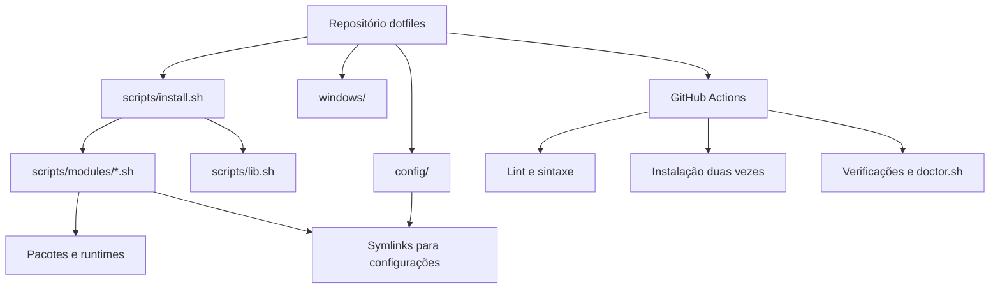
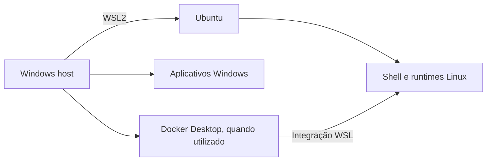

# Architecture

> Documentação técnica dos dotfiles de desenvolvimento para Ubuntu 24.04 e WSL2.
>
> **Estado:** descreve a arquitetura observada nos scripts compartilhados e distingue integrações ainda pendentes de verificação.

## 1. Objetivo e escopo

Este repositório mantém, sob controle de versão, a instalação e a configuração de um ambiente de desenvolvimento orientado a Java/Spring, Node.js/React, Python e ferramentas de terminal.

O objetivo é permitir que uma máquina nova seja preparada por scripts reproduzíveis, reduzindo configurações manuais e facilitando manutenção e diagnóstico. O projeto não é um gerenciador de infraestrutura de servidores nem substitui os gerenciadores de pacotes de cada ecossistema.

**Ambientes:** Ubuntu 24.04 no WSL2 é o alvo principal; GitHub Actions executa testes em um runner Ubuntu 24.04. Windows é o host e possui uma área própria de automação. As capacidades do runner Linux e do WSL2 não são idênticas.

## 2. Visão geral



O fluxo principal parte de `scripts/install.sh`, que carrega a biblioteca compartilhada, importa os módulos e os executa em ordem definida. Os módulos encapsulam responsabilidades específicas. Configurações versionadas são associadas aos caminhos esperados pelas ferramentas por meio de links simbólicos, quando implementados pelo módulo correspondente.

## 3. Organização do repositório

```text
dotfiles/
├── .github/workflows/ci.yml
├── config/
│   ├── claude/settings.json
│   ├── git/.gitconfig
│   ├── opencode/opencode.json
│   └── zsh/
│       ├── .zshrc
│       └── .p10k.zsh
├── scripts/
│   ├── install.sh
│   ├── update.sh
│   ├── doctor.sh
│   ├── lib.sh
│   └── modules/
│       ├── ai.sh
│       ├── base.sh
│       ├── docker.sh
│       ├── git.sh
│       ├── java.sh
│       ├── node.sh
│       ├── python.sh
│       ├── shell.sh
│       └── wsl.sh
├── windows/
│   ├── setup.ps1
│   └── packages.json
└── wsl/
    └── .wslconfig
```

Esta árvore representa os caminhos compartilhados na conversa. Confirme a existência e o conteúdo de arquivos adicionais, especialmente `wsl.conf` e eventuais arquivos de ignore global, antes de incluí-los na documentação definitiva.

### Responsabilidades

| Caminho | Responsabilidade |
| --- | --- |
| `scripts/install.sh` | Ponto de entrada para provisionar o ambiente. |
| `scripts/lib.sh` | Helpers compartilhados, variáveis de versão e funções de instalação. |
| `scripts/modules/base.sh` | Dependências de sistema e utilitários. |
| `scripts/modules/shell.sh` | Zsh, tema, plugins e configurações do shell. |
| `scripts/modules/git.sh` | Configuração versionada do Git. |
| `scripts/modules/java.sh` | SDKMAN, Java Temurin e Maven. |
| `scripts/modules/node.sh` | NVM, Node.js e ferramentas associadas. |
| `scripts/modules/python.sh` | Ferramentas do ecossistema Python. |
| `scripts/modules/docker.sh` | Configuração/validação de Docker conforme o ambiente. |
| `scripts/modules/ai.sh` | Integração das ferramentas de IA; implementação precisa ser revisada. |
| `scripts/modules/wsl.sh` | Ajustes específicos de WSL; implementação precisa ser revisada. |
| `scripts/update.sh` | Ponto de entrada de manutenção; operações exatas dependem do conteúdo do script. |
| `scripts/doctor.sh` | Diagnóstico do ambiente; verificações exatas dependem do conteúdo do script. |
| `windows/` | Automação do host Windows, separada da instalação Linux. |

## 4. Fluxo de instalação

O `install.sh` utiliza `set -euo pipefail`, determina a raiz do repositório a partir de seu próprio caminho, exporta `DOTFILES_DIR`, carrega `lib.sh` e importa os módulos.

A ordem de execução compartilhada é:

```text
base_install
  ↓
shell_install
  ↓
git_install
  ↓
java_install
  ↓
node_install
  ↓
python_install
  ↓
docker_install
  ↓
ai_install
  ↓
wsl_install
```

Essa ordem explicita dependências: primeiro ferramentas de sistema e shell, depois configurações e runtimes, e finalmente integrações. Ao final, o instalador avisa caso o shell padrão não seja Zsh.

### Erros e segurança de execução

- `set -e`: interrompe o script diante de falhas não tratadas.
- `set -u`: acusa variáveis não definidas.
- `pipefail`: propaga falhas em pipelines.
- Funções que precisam executar ferramentas incompatíveis com `nounset`, como determinados comandos do SDKMAN, desativam essa opção temporariamente e restauram o estado anterior.
- Comandos externos devem propagar seus códigos de saída; não devem ser tratados como sucesso silenciosamente.

## 5. Configurações declarativas e symlinks

A função compartilhada `link(origem, destino)` recebe **exatamente dois argumentos**. Seu comportamento observado é:

1. Valida a quantidade de argumentos e a existência da origem.
2. Cria o diretório pai do destino, se necessário.
3. Não faz nada quando o destino já é um symlink correto.
4. Remove um symlink anterior, caso aponte para outro lugar.
5. Faz backup de um arquivo regular existente, com sufixo `.bak.YYYYMMDDHHMMSS`.
6. Cria o novo link simbólico.

Exemplo conceitual:

```text
~/dotfiles/config/git/.gitconfig
             │
             └── symlink → ~/.gitconfig
```

**Atenção:** a presença de um arquivo em `config/` não comprova que ele está sendo linkado. Isso depende de uma chamada explícita em seu módulo.

### Idempotência

Executar o instalador mais de uma vez não deve duplicar configurações nem destruir arquivos existentes. O helper de links evita recriar links corretos; os módulos precisam adotar verificações equivalentes para instalações e alterações de sistema.

A CI executa o instalador duas vezes, fornecendo uma verificação prática de repetibilidade. Isso não prova idempotência em todos os estados possíveis de uma máquina real.

## 6. Gerenciamento de versões

Valores padrão compartilhados em `lib.sh`:

```bash
JAVA_MAJOR="${JAVA_MAJOR:-21}"
JAVA_VENDOR="${JAVA_VENDOR:-tem}"
NODE_MAJOR="${NODE_MAJOR:-24}"
```

- **Java:** SDKMAN instala/seleciona `21-tem` (Temurin), com Maven gerenciado pelo SDKMAN.
- **Node.js:** NVM resolve uma versão da linha major configurada e define o alias `default`.
- **Python:** a integração usa `uv`, conforme o módulo Python.

Esses valores representam **linhas de versão**, não um lockfile imutável: versões patch podem mudar entre execuções. Para builds rigorosamente reproduzíveis, seria necessário fixar versões completas e revisar dependências externas.

## 7. Separação Windows e WSL



- `windows/setup.ps1` e `windows/packages.json` destinam-se ao provisionamento de aplicativos do Windows. É necessário inspecionar o conteúdo para documentar o comportamento exato.
- `wsl/.wslconfig` configura recursos da VM WSL pelo lado do Windows, normalmente em `%USERPROFILE%\.wslconfig`.
- `/etc/wsl.conf`, quando gerenciado, configura opções da distribuição Linux. **Não é o mesmo arquivo que `.wslconfig`.**
- Quando Docker Desktop fornece o daemon via integração WSL, não é necessário instalar outro Docker Engine dentro da distribuição. O módulo Docker deve tratar explicitamente a diferença entre WSL e Ubuntu nativo.

## 8. OpenCode e Claude Code

Os caminhos de configuração presentes na estrutura são:

```text
config/opencode/opencode.json
config/claude/settings.json
```

A integração completa exige conferir, para cada ferramenta:

1. Instalação e atualização da CLI.
2. Caminho de configuração efetivamente utilizado pela versão instalada.
3. Criação de symlink ou cópia controlada.
4. Separação entre preferências versionáveis e autenticação local.
5. Diagnóstico no `doctor.sh` e testes adequados na CI.

**Estado:** a existência desses arquivos foi identificada; a instalação e o vínculo automático ainda precisam ser validados contra `scripts/modules/ai.sh`. Não versionar tokens, sessões ou credenciais.

## 9. Git e segurança

A configuração global pode ser versionada em `config/git/.gitconfig`, enquanto dados pessoais ou dependentes da máquina podem ficar em `~/.gitconfig.local` e ser incluídos pela configuração principal.

Para assinatura SSH de commits, a chave privada deve permanecer fora do repositório. O repositório pode documentar o procedimento e os caminhos esperados, mas nunca armazenar chaves privadas, tokens ou arquivos de sessão.

Outras medidas recomendadas:

- Usar HTTPS e fontes oficiais para instaladores.
- Revisar alterações de scripts antes de executá-los.
- Evitar executar o instalador inteiro como `root`; usar `sudo` apenas nos passos necessários.
- Fazer backup antes de substituir configurações existentes.
- Não assumir que `GITHUB_TOKEN` e credenciais locais são intercambiáveis.

## 10. CI: testes e limites

O workflow `.github/workflows/ci.yml` contém dois jobs:

### `lint`

- ShellCheck nos scripts Bash.
- `bash -n` para sintaxe Bash.
- `zsh -n` para `.zshrc` e `.p10k.zsh`.
- Validação da configuração Git com `git config --list`.

### `install`

Executado em `ubuntu-24.04`, após o lint:

1. Faz checkout do repositório em `dotfiles/`.
2. Executa `bash dotfiles/scripts/install.sh`.
3. Executa o mesmo instalador novamente.
4. Inicializa os ambientes necessários e verifica Java, Maven, Node, pnpm, yq e uv.
5. Verifica symlinks essenciais de Zsh e Git.
6. Executa `scripts/doctor.sh`.

**Limites:** o runner não é um Windows host nem uma sessão WSL2 real. A CI não comprova o funcionamento do PowerShell, da configuração da VM WSL, da integração Docker Desktop nem de autenticações interativas das CLIs de IA.

## 11. Manutenção e diagnóstico

```bash
# Instalação inicial
bash scripts/install.sh

# Manutenção (verificar as operações implementadas no script)
bash scripts/update.sh

# Diagnóstico
bash scripts/doctor.sh

# Validação estática
shellcheck -x scripts/*.sh scripts/modules/*.sh
for f in scripts/*.sh scripts/modules/*.sh; do bash -n "$f"; done
```

Mudanças de comportamento devem ser implementadas no módulo responsável, testadas localmente e validadas pela CI. Evite duplicar comandos de instalação em `install.sh`, `update.sh` e scripts Windows sem uma razão explícita.

## 12. Próximos passos

### Integração de IA

- [ ] Revisar `ai.sh` e os dois arquivos de configuração.
- [ ] Confirmar caminhos e formato das configurações nas versões instaladas.
- [ ] Garantir instalação e symlinks repetíveis.
- [ ] Manter credenciais fora do Git.
- [ ] Ampliar o diagnóstico sem exigir login na CI.

### Automação Windows

- [ ] Revisar `setup.ps1` e `packages.json`.
- [ ] Definir lista mínima de aplicativos Windows.
- [ ] Implementar checagem de pré-requisitos, instalação e reexecução segura.
- [ ] Documentar a aplicação de `.wslconfig` e reinicialização do WSL.
- [ ] Considerar validação PowerShell e JSON em CI separada.

### Qualidade

- [ ] Revisar o comportamento exato de `update.sh` e `doctor.sh`.
- [ ] Adicionar testes específicos para helpers críticos.
- [ ] Considerar testes de integração WSL/Windows fora do runner Ubuntu.
- [ ] Manter README e este documento sincronizados com a implementação.

## 13. Princípios de projeto

1. **Modularidade:** cada ecossistema tem um módulo responsável.
2. **Repetibilidade:** executar novamente não deve destruir o ambiente.
3. **Configuração versionada:** preferências compartilháveis ficam no Git.
4. **Segredos locais:** credenciais e chaves privadas nunca são commitadas.
5. **Separação de ambientes:** Windows host, WSL e Ubuntu de CI têm responsabilidades distintas.
6. **Falhas visíveis:** erros devem interromper a instalação e ser diagnosticáveis.
7. **Documentação fiel:** distinguir comportamento implementado de funcionalidades planejadas.
